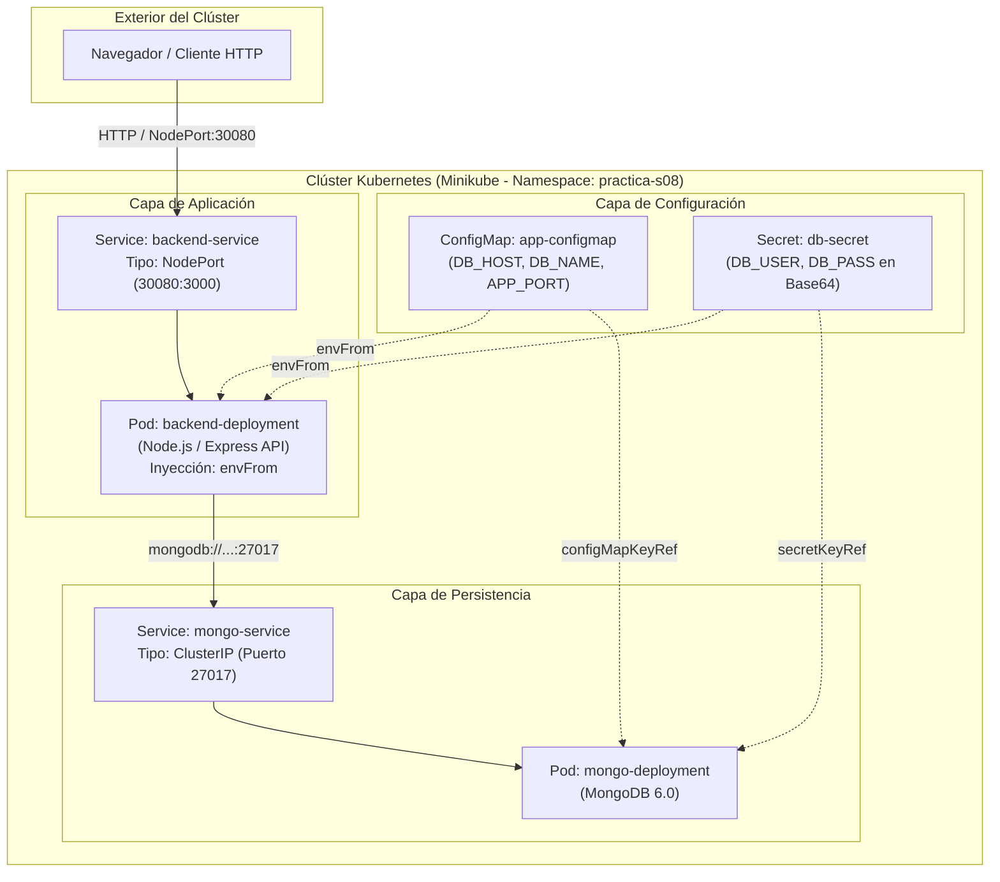

# Proyecto Práctico: Exposición de Servicios y Configuración Segura en Minikube (S08 | AP6)

## 📌 Información General
- **Curso:** Orquestación y Automatización de Software
- **Sesión:** S08 | AP6
- **Entorno:** Minikube (Kubernetes Local) + `kubectl`
- **Arquitectura:** 2 Capas (Backend API Node.js/Express + Base de Datos MongoDB)

---

## 🏛️ Arquitectura del Sistema

La solución implementa una topología desacoplada y segura dentro de un Namespace aislado (`practica-s08`):



### Principios Clave Aplicados
1. **Desacoplamiento de Configuración (ConfigMap):** Los parámetros operativos no sensibles (`DB_HOST`, `DB_NAME`, `APP_PORT`) se administran fuera de la imagen Docker en texto claro dentro del `ConfigMap`.
2. **Seguridad de Credenciales (Secret):** Las credenciales de autenticación (`DB_USER`, `DB_PASS`) se gestionan mediante un objeto `Secret` de tipo `Opaque` codificadas en Base64.
3. **Inyección en Bloque (`envFrom`):** El Deployment del Backend inyecta dinámicamente todas las claves del ConfigMap y Secret en las variables de entorno del contenedor sin quemar valores en código.
4. **Aislamiento de Red:** 
   - **MongoDB:** Expuesto **únicamente de forma interna** mediante un servicio `ClusterIP`. No tiene IP externa ni puerto accesible fuera del clúster.
   - **Backend:** Expuesto hacia el exterior mediante un servicio `NodePort` en el puerto `30080`.

---

## 📁 Estructura del Repositorio

```text
/
├── k8s/
│   ├── 01-app-configmap.yaml     # Variables no sensibles (DB_HOST, DB_NAME, APP_PORT)
│   ├── 02-db-secret.yaml            # Credenciales confidenciales codificadas en Base64
│   ├── 03-mongo-stack.yaml          # Deployment de MongoDB + Service ClusterIP
│   └── 04-backend-stack.yaml        # Deployment de Backend (envFrom) + Service NodePort
├── src/
│   ├── Dockerfile                   # Imagen ligera multi-plataforma (Node 20 Alpine)
│   ├── package.json                 # Dependencias (Express, MongoDB driver)
│   └── server.js                    # Código del Backend con UI web interactiva y healthchecks
└── README.md                        # Documentación técnica completa
```

---

## ⚙️ Guía de Despliegue Paso a Paso

### 1. Iniciar Minikube
Asegúrate de tener Minikube iniciado:
```bash
minikube start
```

### 2. Crear el Namespace de la Práctica
Aislamos los recursos de la sesión en el namespace `practica-s08`:
```bash
kubectl create namespace practica-s08
```

### 3. Construir la Imagen Docker en el Entorno de Minikube
Para que Kubernetes pueda utilizar la imagen local sin requerir un registro público externo, construye la imagen dentro del demonio de Minikube:

**Opción A (Recomendada):**
```bash
minikube image build -t backend-api:1.0 ./src
```

**Opción B (Alternativa con el entorno Docker de Minikube):**
```bash
eval $(minikube docker-env)
docker build -t backend-api:1.0 ./src
```

### 4. Aplicar los Manifiestos de Kubernetes en Orden

```bash
# Paso 2: Crear el ConfigMap
kubectl apply -f k8s/01-app-configmap.yaml

# Paso 3: Crear el Secret
kubectl apply -f k8s/02-db-secret.yaml

# Paso 4: Desplegar MongoDB (Deployment + Service ClusterIP)
kubectl apply -f k8s/03-mongo-stack.yaml

# Paso 5: Desplegar Backend API (Deployment con envFrom + Service NodePort)
kubectl apply -f k8s/04-backend-stack.yaml
```

---

## 🔍 Verificación y Evidencias Requeridas

### Evidencia 1: Estado del Clúster
Verificar que todos los pods, servicios, configmaps y secrets estén creados y en estado **Running**:
```bash
kubectl get pods,svc,configmaps,secrets -n practica-s08
```
*Salida esperada:*
- Pods `backend-deployment-*` y `mongo-deployment-*` en estado `Running (1/1)`.
- Servicio `mongo-service` de tipo `ClusterIP`.
- Servicio `backend-service` de tipo `NodePort`.
- ConfigMap `app-configmap` y Secret `db-secret` listados.

### Evidencia 2: Inyección de Variables en el Contenedor (Verificación de Seguridad)
Comprobar que tanto las variables del `ConfigMap` como las del `Secret` se inyectaron exitosamente en el entorno del pod backend:
```bash
# Obtener el nombre del pod
POD_NAME=$(kubectl get pods -n practica-s08 -l app=backend-api -o jsonpath="{.items[0].metadata.name}")

# Inspeccionar variables de entorno
kubectl exec -it $POD_NAME -n practica-s08 -- env | grep -E "DB_|APP_"
```
*Variables que deben aparecer:*
```text
DB_HOST=mongo-service
DB_NAME=appdb
APP_PORT=3000
DB_USER=admin
DB_PASS=SecretPass123
```

### Evidencia 3: Acceso al Servicio vía NodePort desde el Navegador
Obtener la URL de acceso externa asignada por Minikube:
```bash
minikube service backend-service -n practica-s08 --url
```
Abre la URL proporcionada en el navegador web (por ejemplo `http://192.168.49.2:30080` o la IP de Minikube). Verás la consola visual interactiva mostrando:
- Estado de la Base de Datos: **CONECTADO** (comunicación exitosa vía ClusterIP).
- Desglose de variables inyectadas desde **ConfigMap** y **Secret**.
- Botón de prueba CRUD (`/api/test-db`) que inserta y consulta registros en MongoDB.

---

## 🧹 Limpieza del Entorno
Para eliminar todos los recursos creados en esta práctica:
```bash
kubectl delete namespace practica-s08
```
